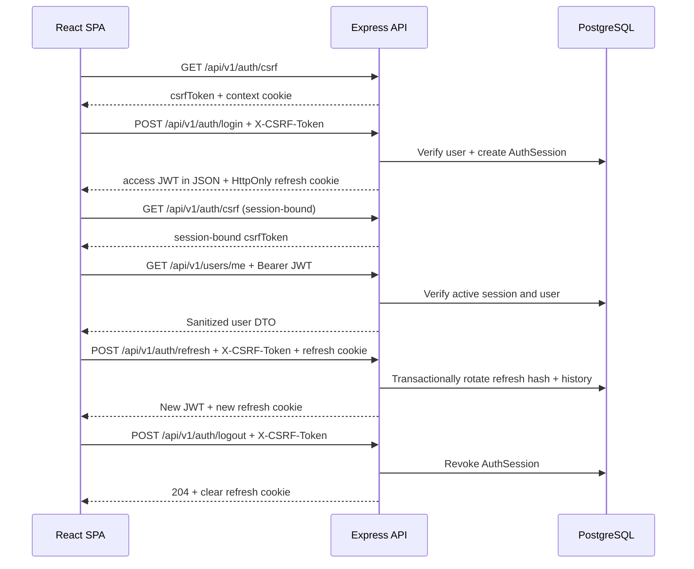

# StreamLab Authentication — Lifecycle and boundaries

**Task:** STREAM-002.1. **Current status:** design only; endpoints remain `planned` except health endpoints.

## Token / cookie transmission

## Responsibility map

| Path                                                   | Responsibility                                                                      |
| ------------------------------------------------------ | ----------------------------------------------------------------------------------- |
| `apps/api/src/routes/auth.routes.ts`                   | Route definitions and auth middleware composition                                   |
| `apps/api/src/controllers/auth.controller.ts`          | HTTP input/output and Set-Cookie                                                    |
| `apps/api/src/services/auth.service.ts`                | Account registration, login, refresh and logout rules                               |
| `apps/api/src/services/token.service.ts`               | JWT issuance/verification and secure random refresh values                          |
| `apps/api/src/repositories/user.repository.ts`         | User queries                                                                        |
| `apps/api/src/repositories/auth-session.repository.ts` | Sessions / consumed refresh digests                                                 |
| `apps/api/src/schemas/auth.schema.ts`                  | API-only validation that composes shared request schemas                            |
| `apps/api/src/middlewares/auth.middleware.ts`          | Bearer authentication and active-session enforcement                                |
| `apps/api/src/middlewares/authorize.middleware.ts`     | Persisted role / owner policies                                                     |
| `apps/api/src/middlewares/csrf.middleware.ts`          | CSRF and Origin validation                                                          |
| `packages/contracts/src/api/auth.ts`                   | Shared JSON request/response DTOs and Zod schemas                                   |
| `apps/api/docs/openapi/openapi.yaml`                   | OpenAPI wire format and security schemes                                            |
| `apps/web/src/features/auth/...`                       | React auth UI, hooks, types and feature services                                    |
| `apps/web/src/lib/axios.ts`                            | Common HTTP client / credentials policy                                             |
| `apps/web/src/stores/auth.store.ts`                    | Access token and minimal client-only auth state, not redundant server profile cache |

Do not add `src/modules/` to the API. Avoid user data in the Worker unless a genuine job requires it.

## Known deltas to STREAM-001.9

1. Add `GET /api/v1/auth/csrf` + response DTO and CSRF response/cookie policy.
2. Add `X-CSRF-Token` requirement to register/login (refresh/logout already specify it).
3. Keep existing `AuthSessionResponseSchema` body unchanged: access token in JSON, refresh token in cookie.
4. Confirm cookie name remains `streamlab_refresh` in OpenAPI (provisional as of STREAM-001.9).
5. Only remove `x-streamlab-status: planned` for an endpoint **after** it is actually implemented and tested.

## Work sequence

- STREAM-002.2: registration + Argon2id + API CRUD contracts; implement CSRF bootstrap as prerequisite for registration if CSRF is enforced from the start.
- STREAM-002.3: login + access JWT issuance + verification.
- STREAM-002.4: refresh token rotation / session migrations / replay.
- STREAM-002.5: logout, `/users/me`, session and permission checks.
- STREAM-002.6: React auth providers/hooks/client flow.
- STREAM-002.7: login/register UI and route guards.
- STREAM-002.8: focused security tests, race and replay tests.
- STREAM-002.9: integration and browser E2E.
