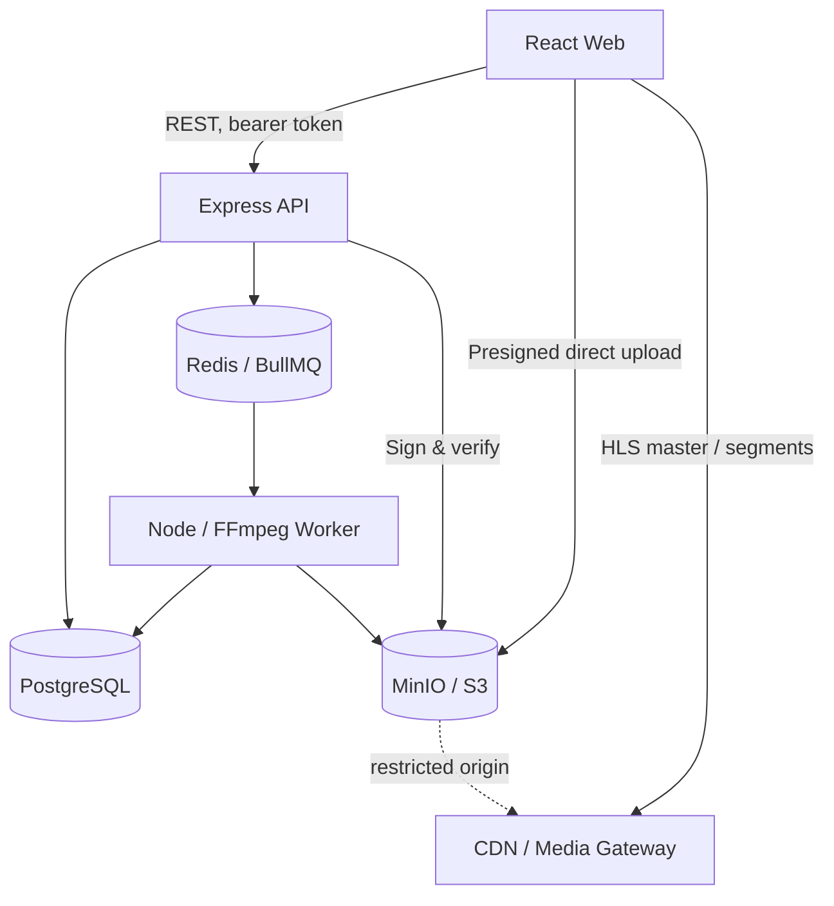

# StreamLab — Architecture overview

**Milestone:** STREAM-001.1 | **Date:** 2026-11-23 | **Product:** VOD platform (YouTube-like creator upload, Netflix-like watch experience)

## Architecture goals

1. Keep the established web feature-first and API technical-layer organization.
2. Protect API latency while processing large videos asynchronously.
3. Scale web/API and worker independently, avoiding unnecessary distributed services.
4. Keep original assets private, provide safe playback authorization, and avoid upload proxying.
5. Preserve recoverability under queue/storage/worker failures.

## Logical diagram

## Process responsibilities

| Component         | Owns                                                                              | Must not do                                     |
| ----------------- | --------------------------------------------------------------------------------- | ----------------------------------------------- |
| `apps/web`        | UI, TanStack Query, uploads, HLS player                                           | Hold storage secrets or make trust decisions    |
| `apps/api`        | Auth, ownership, metadata, upload sessions, queue intents, playback authorization | Process video via FFmpeg inside HTTP request    |
| `apps/worker`     | FFprobe, transcode, HLS output, finalization and cleanup jobs                     | Serve public API or run migrations              |
| PostgreSQL        | Durable metadata, job intent, status                                              | Store full video binary                         |
| Redis/BullMQ      | Background work delivery, retries                                                 | Be only durable record of processing state      |
| Object storage    | Original media, HLS assets, posters                                               | Accept unrestricted uploads/deletes from client |
| CDN/media gateway | Media delivery, path-scoped authorization                                         | Replace API ownership checks                    |

## Data flows

### A. Video upload

1. Authenticated creator `POST /api/v1/videos` creates a DRAFT video.
2. Creator `POST /api/v1/videos/:id/uploads`: API validates ownership/quota, creates upload record and presigned operation(s).
3. Browser uploads directly to storage on an isolated object key.
4. Client `POST /api/v1/uploads/:id/complete`; API independently verifies storage bytes/attributes and marks VERIFIED upload.
5. API writes durable queue intent, then enqueues; reconciler handles partial failure.

### B. Processing

1. Worker consumes `{videoId, uploadId, processingVersion}`.
2. It rechecks DB ownership/state/version and verifies the original via FFprobe.
3. FFmpeg generates HLS rendition(s) under versioned prefix; generate poster, playlists, segments.
4. Validate artifacts, then atomically/transactionally advance active metadata/status to READY.
5. Retry transient errors. Mark irrecoverable formats FAILED. Old outputs cleaned asynchronously.

### C. Playback

1. Viewer requests metadata and playback authorization from API.
2. API checks Video READY, visibility/publishing state and user permission.
3. API responds with a delivery URL/authorization mechanism. Media gateway/CDN enforces access to ALL HLS playlists/segments for PRIVATE media.
4. React hls.js loads media (native HLS fallback), updates watch progress in API.

## MVP scope / exclusions

Included: auth, video metadata, uploads, transcoding, HLS playback, discovery, history, creator dashboard, reliability basics and CI. Excluded: live streaming, subscriptions/payments, DRM, ML recommendations, advanced analytics.

## Cross-boundary rules

- Web → API only through versioned HTTP contracts.
- API → worker only through queue payload contract; no direct function invocation.
- Web may upload to object storage using short-lived signed operations; storage credentials never go to browser.
- Worker and API share database access via controlled packaging while API owns schema/migrations; never cross-import other app's `src`.
- One source of truth for processing state in PostgreSQL; jobs are replayable.

## Open implementation choices (NOT architecture blockers)

- Worker/API Prisma generated client packaging implementation.
- Multipart upload threshold, max size/quota and presigned TTL.
- Concrete local private-media gateway implementation.
- Exact refresh token TTL/session constraints and account deletion retention.
- Initial thumbnail count and encoding bitrate ladder.

These are scoped for STREAM-001.2/001.5, STREAM-002, STREAM-004 and STREAM-006 respectively, not silently considered final decisions.
